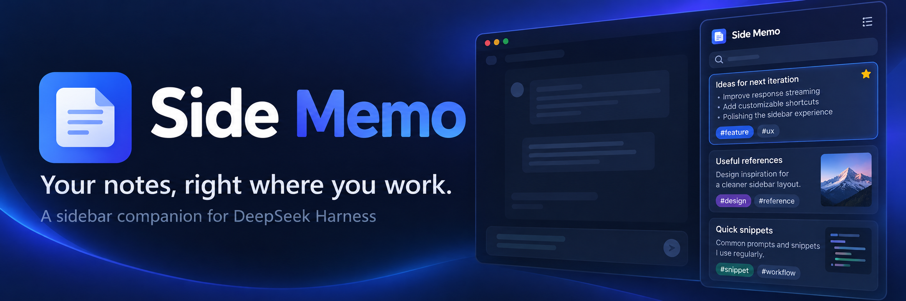
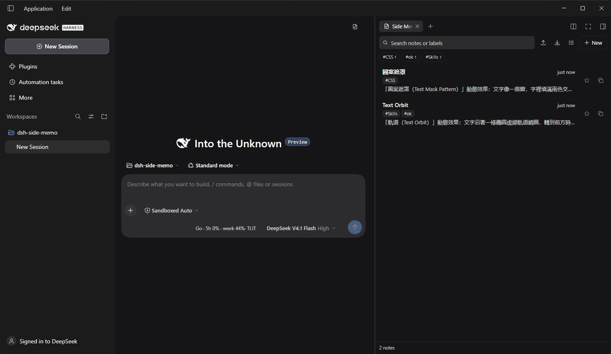

# 側邊便箋（Side Memo）



**語言：** [English](README.md) · [简体中文](README.zh-CN.md) · **繁體中文**



一個輕量、可開關的 **右側便箋面板**，為 [DeepSeek Harness](https://deepseek.com/harness) 打造。聊天時隨手記下內容——文字、內嵌圖片與標籤——一鍵複製，收藏常用便箋讓它始終置頂，還能把所有便箋整批匯入或匯出為 Excel 活頁簿。

[](LICENSE)

[](https://www.npmjs.com/package/dsh-side-memo)
[](https://github.com/r48n34/dsh-side-memo/actions/workflows/ci.yml)


**分類：** 介面與體驗

## 安裝

`dsh-side-memo` 已[發佈到 npm](https://www.npmjs.com/package/dsh-side-memo)。透過你的 DSH 設定檔（profile）安裝：

```bash
dsh plugin --profile web add dsh-side-memo
```

也可以直接從這個儲存庫安裝——當需要的提交尚未發佈到 npm，或無法連線到 npm 時，使用 GitHub 形式：

```bash
dsh plugin --profile web add github:r48n34/dsh-side-memo
```

如果你的 DSH 執行的是 Desktop 設定檔（profile），請使用 **設定 → 外掛**（Settings → Plugins）中顯示的設定檔名稱（Desktop 應用程式通常是 `desktop`）：

```bash
dsh plugin --profile desktop add dsh-side-memo
```

安裝後，**側邊便箋** 圖示已經出現在工作階段標題列上——位於標題列最右側，包括尚未建立任何工作階段時（首屏）以及新工作階段歡迎畫面。你可以從那裡開啟它，也可以從工作階段標題列右側的功能區，或右側邊欄的加入/引導控制項開啟。如果沒看到圖示，請重新啟動 DSH 一次，讓新的外掛套件完成載入。

要移除它，請在 DSH 的 **設定 → 外掛** 中操作（或使用與你的設定檔對應的 `dsh plugin` 指令）。

## 功能

- **便箋面板** —— 透過標題列開關開啟；尚無工作階段時使用浮動抽屜，建立後改用右側邊欄分頁。
- **編輯與收藏** —— 便箋自動儲存；收藏置頂，其餘依更新時間排序。可在編輯器直接新增便箋，空白草稿會被沿用；刪除需按兩次確認。
- **圖片與複製** —— 可貼上、插入或拖放圖片，圖片會縮小並儲存在本機。複製時使用內文，內文為空時使用標題；只有圖片的便箋會複製第一張圖片。
- **拖入聊天框** —— 把清單中的便箋直接拖到聊天輸入框上，內文會貼到正在編輯的訊息裡。
- **標籤與搜尋** —— 搜尋標題、內文和標籤；每則最多 12 個標籤、每個最多 24 字元，重複標籤不分大小寫。可篩選同時符合多個標籤的便箋，或依標籤分組。
- **Excel 匯入 / 匯出** —— 匯出所有便箋為 `.xlsx`，或附加匯入新便箋，不覆寫現有內容。圖片不會匯出，`Images` 欄僅記錄數量。
- **本機保存** —— 便箋及圖片參照存於瀏覽器的 `localStorage`，圖片資料存於 IndexedDB；重新載入後保留，並在工作階段間共用。

## 使用方式

1. 點標題列最右側的 **側邊便箋** 圖示。尚無工作階段時會開啟浮動抽屜，可按 `Esc` 或關閉按鈕關閉；建立工作階段後會切換至右側邊欄。
2. 點 **新增**，輸入標題與內文；編輯會自動儲存。編輯器頂端的 **新增** 可直接建立下一則便箋。
   - 貼上、用圖片按鈕插入或拖放圖片；移到圖片上點 **×** 可移除。
   - 在 **新增標籤…** 輸入標籤，按 `Enter`、輸入逗號或點到別處即可新增；點標籤上的 **×** 可移除。
3. 點便箋編輯，用星號收藏或複製圖示複製。使用搜尋、標籤篩選或 **依標籤分組** 整理清單；**全部標籤** 可清除篩選。
4. 用工具列匯入 / 匯出圖示處理 Excel。匯入只讀取第一個工作表、略過標題與內文皆空白的資料列，檔案上限為 8 MB。
5. 撰寫訊息時，可直接把便箋從清單拖到聊天輸入框：內文會插入到目前游標位置，便箋中的圖片不會隨文字一起貼上。
6. 再點一次標題列圖示或使用側邊欄收合控制項，即可隱藏面板。

## 相容性

- DeepSeek Harness **0.2.x**（在 **0.2.1-rc.3**、Desktop 設定檔下開發與測試）。
- Web GUI 與 Desktop（Electron/Chromium）。用戶端部分只依賴標準瀏覽器 API：`localStorage`、IndexedDB、Clipboard、File API、`Blob`/`URL`、Canvas，以及用來讀取壓縮 `.xlsx` 檔的 `DecompressionStream('deflate-raw')`。
- 使用內建的右側邊欄外掛 API（`@deepseek-ai/dsh-client-ui-sidebar-right`）；面板是標準的右側邊欄分頁，因此需要一個工作階段來承載它。在任何工作階段出現之前，同一套便箋介面由外掛本身在框架層覆蓋層（`shell.overlay`）中繪製。在工作階段建立前與新工作階段階段，開關會透過常駐標題列的 `conversation.header.leading` 位置掛載，並依即時的標題列/面板開關幾何資訊，把自己定位在標題列最右側。
- 使用工作階段用戶端的輸入框插入 API（`inputActions`）把拖入的便箋以單次可復原的編輯寫入聊天草稿。
- TypeScript 原始碼位於 `src/`；`client.js` 與 `index.js` 是由原始碼編譯並提交到儲存庫的瀏覽器/Host 模組，因此安裝或執行外掛都不需要建置步驟。

## 權限與隱私

- **不存取網路**，也不使用任何外部服務。
- **不存取 Host 資料**，不提供任何給代理程式（agent）使用的工具。Host 端只有空的 `apply()`。
- 便箋與圖片只留在目前瀏覽器（便箋存於 `localStorage` 的 `dsh.side-memo.notes.v1` 鍵，圖片資料存於 `dsh-side-memo-images` 這個 IndexedDB 資料庫）；不會加密，也不會跨裝置同步。
- 只有在你點擊複製時才會寫入剪貼簿。
- Excel 檔透過瀏覽器的檔案選擇器/下載在你的電腦上讀寫——絕不會被上傳。

## 已知限制

- 僅限瀏覽器本機儲存：無法跨裝置或跨瀏覽器同步。
- 沒有工作階段時，便箋會在外掛自帶的浮動抽屜中開啟（右側邊欄本身是工作階段範圍的）；抽屜與右側邊欄分頁是同一套便箋的兩種不同宿主。
- 拖入聊天框需要已建立工作階段且輸入框可編輯；只會貼上便箋的純文字，圖片與標籤不會隨文字一起貼上。
- 文字為純文字（不支援 Markdown 或富文字格式）；圖片是唯一的豐富內容。圖片在儲存前會先縮小，也不會匯出到 Excel——`Images` 欄只記錄數量。
- 圖片功能需要 IndexedDB 與 Canvas。若瀏覽器封鎖 IndexedDB，文字便箋仍可正常運作，但插入圖片會被停用。
- Excel 匯入只讀取第一個工作表；公式會以其快取值匯入，儲存格中的富文字格式會被忽略。
- 上限：300 則便箋、標題 120 個字元、內文 8,000 個字元、每則便箋 12 個標籤（每個 24 個字元）、每則便箋 20 張圖片（單張來源圖片不超過 24 MB，儲存前會縮小到最長邊 1,400 像素、品質 0.82）、`.xlsx` 檔 8 MB（解壓後總量不超過 32 MB，壓縮檔內最多 64 個項目），以及瀏覽器圖片總量 60 MB。
- 標籤是扁平標籤——不支援階層、個別標籤顏色或獨立的標籤管理員——而且每個標籤都以個別便箋為單位儲存，所以重新命名一個標籤必須編輯所有帶有它的便箋。
- 收藏只固定在便箋清單內；目前尚未提供只顯示收藏的檢視。

## 開發

TypeScript 原始碼位於 `src/`，僅用 TypeScript 編譯器（不含打包器）編譯成提交在儲存庫中的 `client.js` 與 `index.js`：

| 檔案 | 用途 |
|---|---|
| `package.json` | Bundle/用戶端資訊清單（`dsh.bundle` 修補與 `dsh.client` 瀏覽器模組） |
| `cordis.patch.yml` | 插入 `dsh-side-memo` 的 Loader 列 |
| `index.js` | Host 端（空的 `apply`；由 `src/host/index.ts` 產生） |
| `client.js` | 便箋面板、分頁類型、隨時可用的標題列開關、工作階段前抽屜、localStorage + IndexedDB 儲存、內嵌圖片編輯器、標籤篩選/分組、編輯器頂端列新增便箋按鈕、拖入聊天框貼上、`.xlsx` 匯入/匯出（由 `src/client/` 產生） |
| `src/` | 兩部分的 TypeScript 原始碼 |
| `tsconfig.json`、`scripts/build.mjs` | 型別檢查設定與 `yarn build` 腳本 |
| `locale/en.json`、`locale/zh.json` | 外掛管理員的標題與說明 |
| `icon.svg` | 外掛圖示 |

可以用 DSH 外掛管理員（對此目錄呼叫 `install_bundle`）把它載入某個設定檔，或使用 [安裝](#安裝) 中的指令安裝。套件內容僅限上表所列的執行時檔案——原始碼與建置腳本不會進入發布套件，npm tarball 只是在這些執行時資源之外附帶三個 README 與 LICENSE。

### 測試

- 單元測試：`yarn test` 會先重新建置（`pretest`），再使用 Node.js 內建的 `node --test` 執行（需要 Node.js **>=22**）。第一次執行請先 `yarn install` 安裝建置工具鏈——開發相依套件只有 `typescript` 與 `@types/react`，發布的套件本身沒有相依套件——測試會直接呼叫編譯後的 `client.js` 中的真實輔助函式。
- 瀏覽器端對端測試（選用，僅供開發使用，不包含在 `yarn test` 中）：參見 [`test/e2e/README.md`](test/e2e/README.md)，了解隔離設定檔下的測試環境與執行方式。
- CI 會在每次 push 和 pull request 時執行單元測試：[`.github/workflows/ci.yml`](.github/workflows/ci.yml)。

## 授權條款

[MIT](LICENSE) © 2026 Reemo Studio
